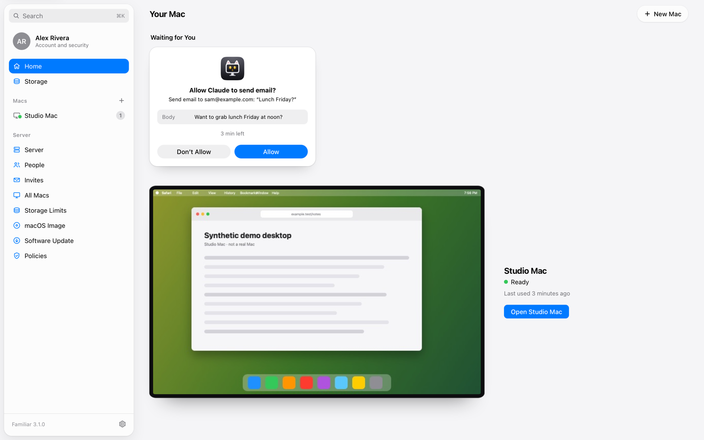
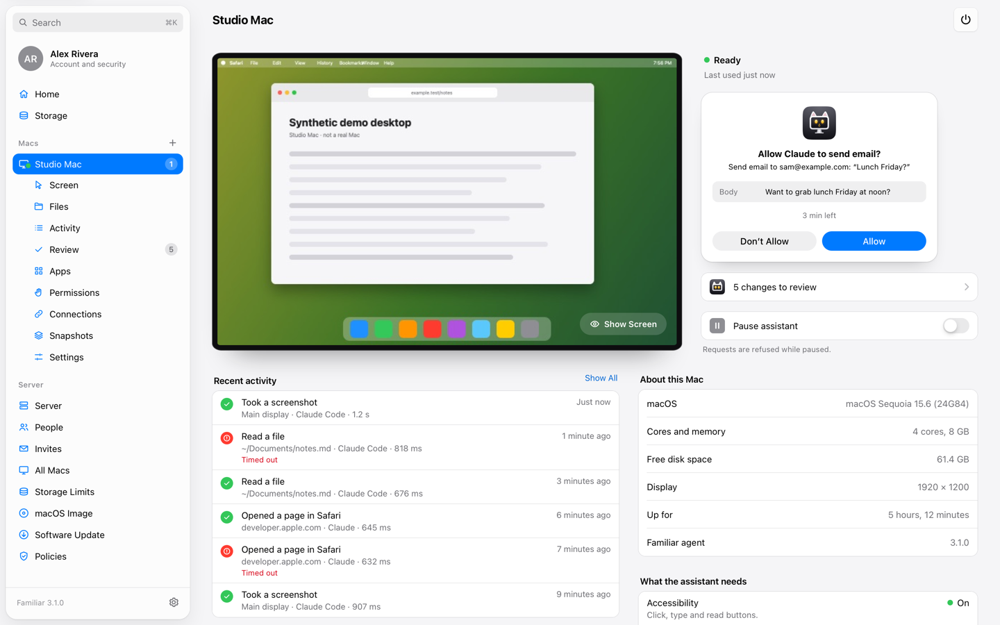
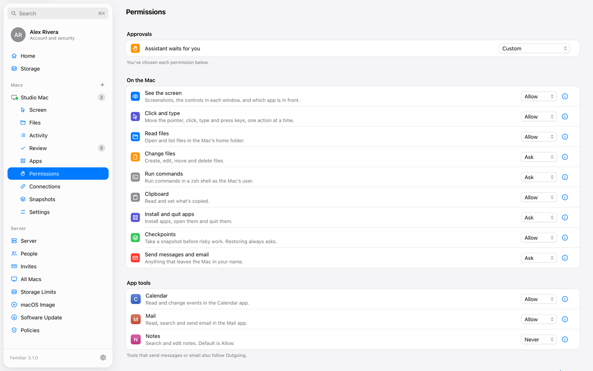
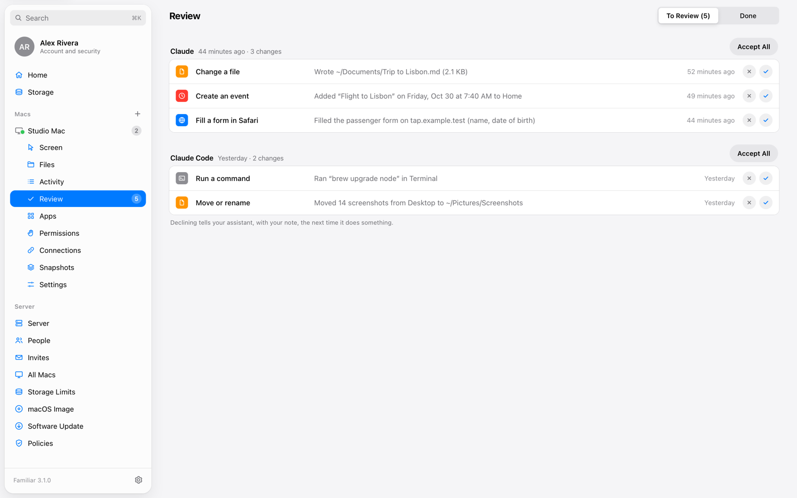
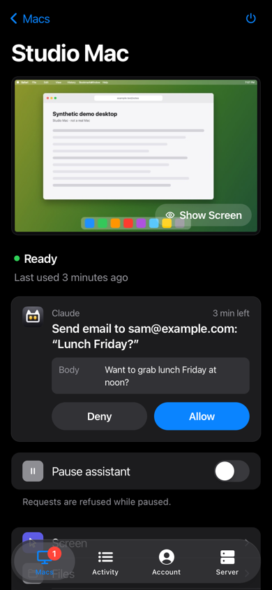

# Familiar

**Give your AI assistant its own Mac, and stay in charge of what it does there.**

Familiar is a self-hosted server for a shared home server. Everyone who signs in gets a
private macOS virtual machine, and their assistant (Claude, ChatGPT, Claude Code or any
MCP client) drives that real Mac over MCP: it sees the screen, clicks and types, uses
Safari, edits files, runs commands and works with any app you install. You decide what
it may do, approve anything risky from your phone, and review everything afterwards.



- **A real Mac, not a sandbox.** Each person gets their own macOS VM (OSX-KVM on
  QEMU/KVM), or connects a Mac they already own. Apps work the way they do for you.
- **Allow, Ask or Never, per ability.** Seeing the screen, typing, changing files, running
  commands, sending messages: each one is a separate switch, and app tools (Calendar,
  Mail, Notes, Messages…) get their own.
- **Approvals that come to you.** When the assistant needs permission it waits; you get a
  push notification and answer with one tap.
- **Review after the fact.** Changes the assistant made are listed for you to accept or
  decline, and declining tells the assistant why the next time it acts.
- **Private by default.** Two-factor sign-in for everyone, per-person encryption at rest,
  and nobody (admins included) can see another person's Mac, files or activity.
- **One container.** Accounts, OAuth, MCP, the portal and the VM supervisor ship as one
  Rust binary with built-in HTTPS.

| Your Mac | What the assistant may do |
| --- | --- |
|  |  |

| Review what changed | On your phone |
| --- | --- |
|  |  |

*Screenshots use the portal's built-in demo with synthetic data.*

## How it works

```
Claude / ChatGPT ──OAuth 2.1──▶ /mcp ──┐
                                       │   dot-home (one Rust binary)
Browser ──cookie + CSRF──▶ /api ───────┤   ├─ accounts, two-factor, invites (SQLite)
          └─ websocket ──▶ /screen ────┤   ├─ OAuth server + personal tokens
                                       │   ├─ tools: built-in Mac tools + app packs
                                       │   ├─ permissions (allow / ask / never) + approvals
                                       │   └─ a supervisor per Mac
                                       │        ├─ QEMU (OSX-KVM): boot, sleep, snapshots
                                       │        └─ authenticated link ──▶ dot-guest
                                       ▼
                       macOS VM, one per person
                       └─ dot-guest: screen capture, Accessibility, input,
                          AppleScript, zsh, Safari, Shortcuts, files
```

The full design is in [docs/home/ARCHITECTURE.md](docs/home/ARCHITECTURE.md).

## Get started

You need a Linux server with hardware virtualization (Intel VT-x or AMD-V), Docker and a
domain name. Plan on about 8 GB of RAM and 60 GB of disk per running Mac.

```bash
git clone https://github.com/reallukedev/familiar && cd familiar
```

```bash
docker compose -f deploy/home/compose.yaml --env-file deploy/home/.env up -d --build
```

Then follow [docs/home/SETUP.md](docs/home/SETUP.md) to create the first admin, build the
macOS base image, invite people and connect an assistant. Connecting looks like this:

- **Claude** (web, desktop, mobile): Settings › Connectors › Add custom connector, URL
  `https://your-server/mcp`.
- **ChatGPT**: Settings › Connectors › Add, same URL.
- **Claude Code**: make a personal token on the Mac's Connect page, then

  ```bash
  claude mcp add --transport http familiar https://your-server/mcp --header "Authorization: Bearer dot_pat_..."
  ```

> [!IMPORTANT]
> Apple's macOS licence allows virtualization only on Apple hardware. Running macOS on
> other hardware is your responsibility. A real Mac (a Mac mini on your network, say)
> works as a remote Mac with the same tools.

## Documentation

| Guide | What's in it |
| --- | --- |
| [SETUP.md](docs/home/SETUP.md) | Installing, the base image, invites, remote Macs, updates |
| [TOOLS.md](docs/home/TOOLS.md) | Every MCP tool the assistant gets, and its error codes |
| [PACKS.md](docs/home/PACKS.md) | Writing app packs that add tools for a Mac app |
| [SECURITY.md](docs/home/SECURITY.md) | Threat model, sign-in, encryption at rest |
| [API.md](docs/home/API.md) | The portal's HTTP API |
| [ARCHITECTURE.md](docs/home/ARCHITECTURE.md) | How the pieces fit together |

## Repository layout

| Path | What it is |
| --- | --- |
| `crates/dot-home` | The server: accounts, OAuth, MCP tools, permissions and approvals, VM supervisor |
| `crates/dot-guest` | The agent inside each Mac |
| `crates/dot-wire` | The protocol between them |
| `crates/dot-home/packs` | Built-in app packs: Calendar, Reminders, Notes, Mail, Messages, Contacts, Music, Finder, Photos |
| `home-web/` | The portal (React, Base UI, Vite), embedded in the server binary |
| `Dockerfile`, `deploy/home/` | Single-container setup, compose file, systemd unit |

## Development

Requires Rust 1.88 or newer and Node 22.

```bash
cargo test --workspace
```

```bash
cd home-web && npm ci && npm run dev
```

Open `http://127.0.0.1:5180/?demo` to use the portal with synthetic demo data (development
builds only). `npm run check`, `npm run test:unit` and `npm run test:web` run type checks,
unit tests and the Playwright suite. Contributions are welcome; see
[CONTRIBUTING.md](CONTRIBUTING.md).

## Security

Please report vulnerabilities privately; see [SECURITY.md](SECURITY.md).

## License

Familiar is free software, licensed under the
[GNU General Public License v3.0 or later](LICENSE).
